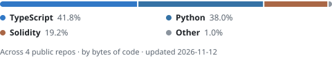

# Hi, I'm Ali Şimşek

Final-year Software Engineering student at **OSTİM Technical University** (Ankara, graduating 2027).
I build full-stack web apps and smart contracts, work on UAV simulation for my capstone, and do computer vision in Python.
I use AI-assisted development (Claude Code) in my daily workflow, and every public project here ships with tests and CI.
**Open to software engineering internships.**

[Launchpad live demo](https://launchpad-cyan-nu.vercel.app) · [LinkedIn](https://www.linkedin.com/in/ali-%C5%9Fim%C5%9Fek-701a88294)

## Featured projects

### [Launchpad](https://github.com/alisimsek55/launchpad) · [Live demo (testnet)](https://launchpad-cyan-nu.vercel.app)

A pump.fun-style bonding-curve token launchpad on Robinhood Chain (an Arbitrum Orbit L2): Solidity contracts, a Ponder indexer and a Next.js trading UI in one monorepo, deployed end to end on free tiers.

- **One-transaction graduation:** the buy that fills the curve also opens a full-range Uniswap v3 position and locks the LP NFT, so the creator cannot pull liquidity. Covered by 39 unit and fuzz tests plus 3 invariants (Foundry, on a mainnet fork), all green in CI.
- **A griefing attack that could block graduation forever:** an attacker could push the pre-created pool's price so far that the correction swap reverts. The fix caps that swap, and a [fuzz test](https://github.com/alisimsek55/launchpad/blob/main/packages/contracts/test/Manipulation.t.sol) throws random manipulations at it.
- **`block.number` is the L1 block on Arbitrum chains**, so deploy scripts read the L2 head over RPC to give the indexer a correct start block. The live indexer lagged the ~7 blocks/s chain; I measured it, moved the service next to its database and cut per-block cache writes, and a full re-index now takes ~3 minutes.

Built with Claude Code as an AI pair programmer: I set the product direction, reviewed the decisions and tested the main flows on the live network; the AI did much of the implementation ([details](https://github.com/alisimsek55/launchpad#how-it-was-built)). The indexer runs on a free tier, so the demo's first load can take about a minute.

**Stack:** Solidity, Foundry, OpenZeppelin, Uniswap v3 · TypeScript, Next.js 16, React 19, wagmi/viem · Ponder, Hono, PostgreSQL · pnpm + Turborepo · GitHub Actions (CI and a cron keeper) · Vercel, Render, Neon

### [Real-time Hand & Face Tracking](https://github.com/alisimsek55/el-yuz-takibi)

A desktop app that tracks hand and face landmarks from a webcam in real time.

- **Responsive GUI:** capture and two neural networks run on a worker thread that publishes only the latest frame behind a lock; the Tk main loop is the only code that touches widgets, and stale frames are dropped instead of queuing.
- **MediaPipe Tasks API:** `HandLandmarker` and `FaceLandmarker` in `VIDEO` mode, with timestamps clamped so two frames in the same millisecond cannot crash the tracker.
- **Testable without hardware:** landmarks become plain tuples at the boundary and the FPS counter takes an injectable clock, so 15 pytest tests run in CI with no camera or model files.

**Stack:** Python, OpenCV, MediaPipe, Tkinter/ttkbootstrap, pytest, GitHub Actions

### [Bean leaf disease classification with a from-scratch CNN](https://github.com/alisimsek55/bean-leaf-disease-cnn)

A 16-layer CNN designed and trained from scratch in PyTorch to tell common bacterial blight, halo blight and healthy bean leaves apart, built for a university "AI in Agriculture" course.

- **Questioning a 97.6% validation accuracy:** each class came mostly from a different image source, so control experiments checked what the model had really learned. The same network identified the image source with 100% accuracy even after background removal, and only 5 of 25 blight leaves from a source it had never seen were classified correctly. The README reports the headline number as an upper bound, not a result.
- **Leakage-safe split:** near-identical frames of the same leaf are grouped with a perceptual hash and kept on one side of the 70/30 split.
- **Preprocessing against shortcuts:** leaves are segmented per source (HSV thresholding, GrabCut) and the background is painted black, so the model cannot classify by backdrop.

**Stack:** Python, PyTorch, OpenCV, scikit-learn, pytest, GitHub Actions

### [TAYGUN: fixed-wing UAV capstone](https://github.com/alisimsek55/TAYGUN-Portfolio)

A university team project. I work on simulation and software integration: running the aircraft in Gazebo with PX4 SITL, monitoring flight state and telemetry in QGroundControl, and processing the simulated camera feed in Python, including detection and tracking experiments on a marked virtual target (simulation only). The flight code lives in a private team repo; the portfolio repo has a project summary and a standalone, tested telemetry-log summarizer that runs on synthetic data. More in [docs/TAYGUN.md](https://github.com/alisimsek55/alisimsek55/blob/main/docs/TAYGUN.md) (Turkish).

**Stack:** PX4 SITL, Gazebo, QGroundControl, MAVLink, ROS 2, Python, OpenCV

## Languages

<picture>
  <source media="(prefers-color-scheme: dark)" srcset="https://raw.githubusercontent.com/alisimsek55/alisimsek55/main/assets/languages-dark.svg">
  <source media="(prefers-color-scheme: light)" srcset="https://raw.githubusercontent.com/alisimsek55/alisimsek55/main/assets/languages-light.svg">
  
</picture>

Generated from my public repos by [a small script](https://github.com/alisimsek55/alisimsek55/blob/main/scripts/language_card.py) and a weekly GitHub Action; generated code is excluded ([config](https://github.com/alisimsek55/alisimsek55/blob/main/languages.config.json)).

## Tech

| Area | Tools I have used in the projects above |
| --- | --- |
| Languages | TypeScript, Solidity, Python |
| Smart contracts | Foundry (unit, fuzz and invariant tests), OpenZeppelin, Uniswap v3 |
| Web and backend | Next.js, React, wagmi/viem, Ponder, Hono, PostgreSQL, REST and GraphQL |
| Computer vision and deep learning | OpenCV, MediaPipe, PyTorch, scikit-learn, Tkinter/ttkbootstrap |
| UAV simulation | PX4 SITL, Gazebo, QGroundControl, MAVLink, ROS 2 |
| Testing and DevOps | pytest, GitHub Actions, Vercel, Render, Neon, pnpm/Turborepo, Linux |

## Contact

[LinkedIn](https://www.linkedin.com/in/ali-%C5%9Fim%C5%9Fek-701a88294)
